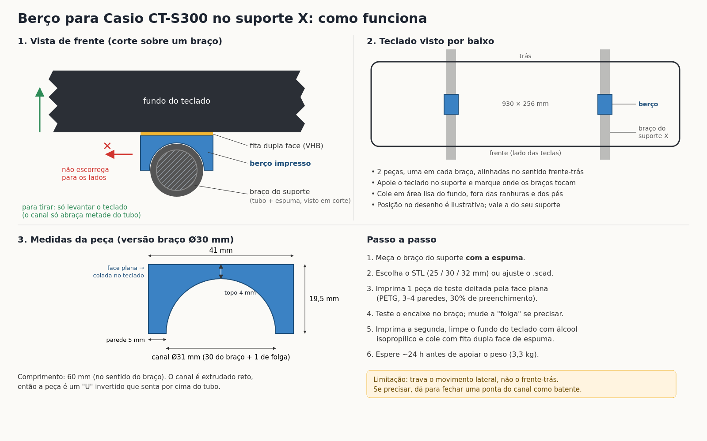
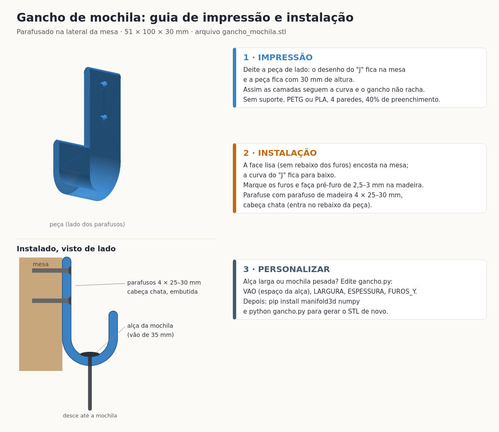
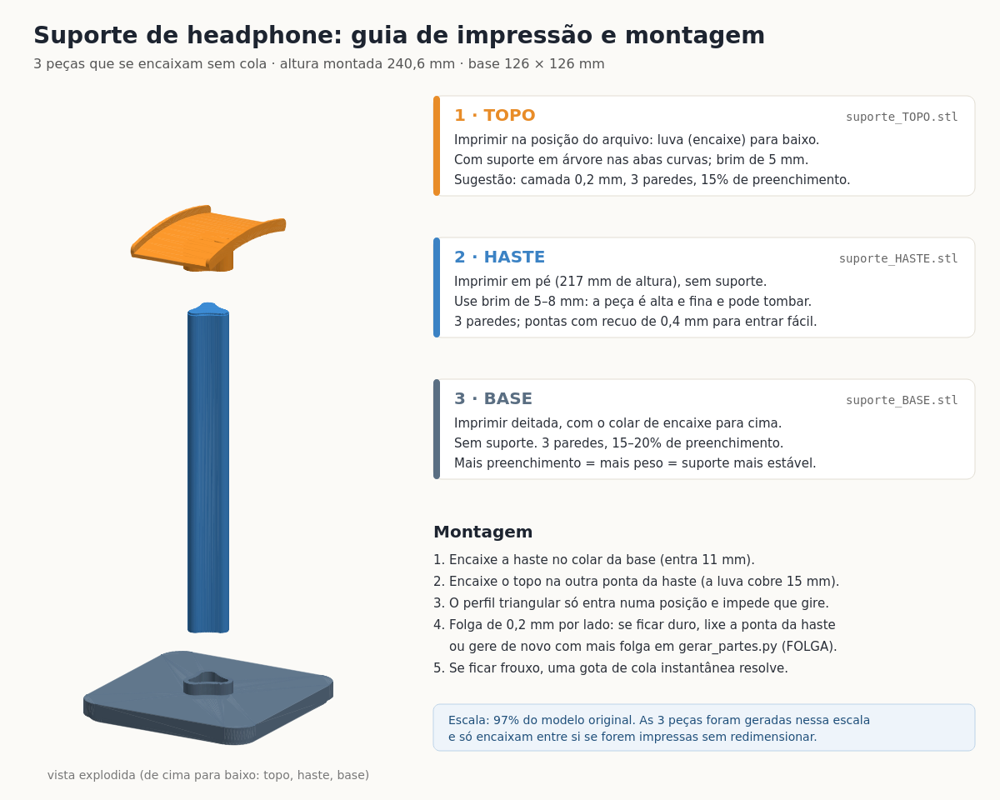
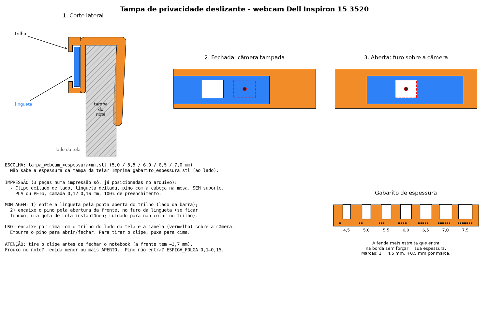
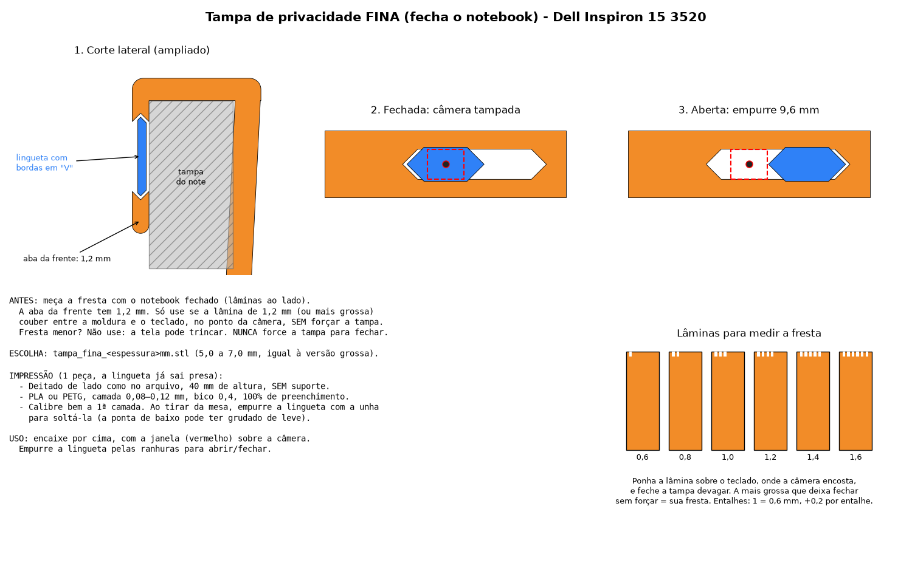

# Modelos 3D

Peças para impressão 3D com guia de impressão e montagem. Cada pasta tem os STLs prontos e uma imagem `guia.png` com o passo a passo.

| Projeto | O que é | Peças |
|---|---|---|
| [Berço para teclado no suporte X](#berço-para-teclado-casio-ct-s300-no-suporte-x) | Calço colado sob o teclado Casio CT-S300 que encaixa no braço de um suporte X e impede o teclado de escorregar | 2× `berco_redondo_*.stl` |
| [Gancho de mochila](#gancho-de-mochila) | Gancho em "J" parafusado na lateral da mesa | 1× `gancho_mochila.stl` |
| [Suporte de headphone](#suporte-de-headphone) | Suporte de mesa em 3 peças que se encaixam (topo, haste e base) | 3 STLs |
| [Tampa de webcam (Dell Inspiron 15 3520)](#tampa-de-webcam-dell-inspiron-15-3520) | Clipe com tampa de privacidade deslizante que encaixa na borda da tela, sem cola. Versão normal e versão fina (fecha o notebook) | 1× `normal/tampa_webcam_*mm.stl` ou `fina/tampa_fina_*mm.stl` |

**Gcodes incluídos:** fatiados para Creality Ender-3 V2 (bico 0,4 mm, camada 0,2 mm, PLA). Para outra impressora, fatie o STL de novo.

---

## Berço para teclado Casio CT-S300 no suporte X



O lado plano é colado com fita dupla face no fundo do teclado. O canal de baixo encaixa sobre o braço do suporte X e impede que o teclado escorregue para os lados; para tirar, basta levantar o teclado.

**Escolha o arquivo pela medida do braço do suporte, com a espuma ou borracha:**

| Braço | Arquivo |
|---|---|
| Redondo Ø25 mm | `berco_redondo_25mm.stl` |
| Redondo Ø30 mm | `berco_redondo_30mm.stl` |
| Redondo Ø32 mm | `berco_redondo_32mm.stl` |
| Quadrado 25 mm | `berco_quadrado_25mm.stl` |
| Outra medida | edite `berco_teclado.scad` no OpenSCAD (`diametro_braco`, `folga`) e exporte |

- **Impressão:** face plana na mesa, canal para cima, **sem suporte**. PETG ou PLA, 3–4 paredes, 15–30% de preenchimento. Imprima 2 peças, uma por braço.
- **Instalação:** apoie o teclado no suporte e marque onde os braços tocam. Limpe com álcool isopropílico e cole com fita dupla face de espuma acrílica (tipo VHB). Espere 24 h antes de apoiar o peso.
- **Limitação:** trava o movimento lateral, não o de frente para trás.

---

## Gancho de mochila



- **Medidas:** 51 × 100 × 30 mm, vão de 35 mm para a alça.
- **Impressão:** deitado de lado (o "J" sobre a mesa, 30 mm de altura), **sem suporte**. Assim as camadas acompanham a curva e o gancho não racha com o peso. PETG ou PLA, 4 paredes, 40% de preenchimento.
- **Instalação:** a face lisa encosta na mesa e a curva fica para baixo. Faça pré-furo de 2,5–3 mm e use 2 parafusos de madeira 4 × 25–30 mm de cabeça chata.
- **Personalizar:** edite os parâmetros no topo de `gancho.py` (`VAO`, `LARGURA`, `ESPESSURA`, `FUROS_Y`) e gere o STL de novo:
  ```bash
  pip install manifold3d numpy
  python gancho.py
  ```

---

## Suporte de headphone



Três peças que se encaixam sem cola. Montado: 240,6 mm de altura, base 126 × 126 mm.

| Peça | Arquivo | Impressão |
|---|---|---|
| Topo | `suporte_TOPO.stl` | Na posição do arquivo (encaixe para baixo), suporte em árvore nas abas curvas, brim 5 mm |
| Haste | `suporte_HASTE.stl` | Em pé (217 mm), sem suporte, brim 5–8 mm por ser alta e fina |
| Base | `suporte_BASE.stl` | Deitada, encaixe para cima, sem suporte |

- **Não redimensione no fatiador:** as 3 peças estão em 97% da escala do modelo original e só encaixam entre si nessa escala.
- **Encaixes:** 0,2 mm de folga por lado. O perfil triangular da haste só entra numa posição e não gira. Se ficar duro, lixe a ponta da haste; se ficar frouxo, uma gota de cola instantânea resolve.
- **Origem:** derivado de um modelo de terceiros ("Supporto-cuffie", Vinors 3d Lab), que não está no repositório. Com o original em `_originais/suporte-headphone/Headphone_Stand_1.stl`, o `gerar_partes.py` gera a base e a haste de novo (por exemplo, com outra `FOLGA`).

---

## Tampa de webcam (Dell Inspiron 15 3520)

Arquivos organizados em pastas:

| Pasta | Conteúdo |
|---|---|
| `normal/` | `tampa_webcam_*mm.stl`, clipe + lingueta + pino numa impressão só, montados depois (frente de ~3,7 mm, tire para fechar o notebook) |
| `fina/` | `tampa_fina_*mm.stl`, frente de 1,2 mm, fecha o notebook com ela no lugar |
| `gabaritos/` | `gabarito_espessura.stl` (espessura da tampa da tela) e `laminas_fresta.stl` (fresta com o notebook fechado) |
| raiz | `tampa.py`, que gera tudo de novo nas pastas acima |



Tampa de privacidade deslizante em forma de clipe. O "U" abraça a borda de cima da tela e sai sem ferramenta. A aba de trás é inclinada 0,8 mm para dentro e prende o clipe por pressão, sem cola. Na frente há uma janela sobre a câmera e um trilho com uma lingueta: empurrando o pino, o furo da lingueta passa para cima da janela (aberta) ou sai dela (fechada). Clipe, lingueta e pino saem na mesma impressão, lado a lado, e são montados depois.

**Escolha o arquivo pela espessura da tampa (só a parte da tela, perto da câmera):**

| Espessura | Arquivo |
|---|---|
| 5,0 / 5,5 / 6,0 / 6,5 / 7,0 mm | `normal/tampa_webcam_5_0mm.stl` … `normal/tampa_webcam_7_0mm.stl` |
| Não sabe | imprima `gabaritos/gabarito_espessura.stl` (fendas de 4,5 a 7,5 mm) e use a fenda mais estreita que entra sem forçar |
| Outra medida | edite `ESPESSURAS_TAMPA` em `tampa.py` e gere de novo |

- **Impressão:** as 3 peças já estão posicionadas no arquivo: clipe deitado de lado (perfil em "U" na mesa, 40 mm de altura), lingueta deitada e pino com a cabeça na mesa. **Sem suporte.** PLA ou PETG, camada de 0,12–0,16 mm, 100% de preenchimento.
- **Montagem:** enfie a lingueta pela ponta aberta do trilho, do lado da barra que une os lábios. Depois encaixe a espiga do pino, pela abertura da frente, no furo quadrado da lingueta. O pino bate na barra de um lado e na parede do outro, então a lingueta não sai mais. Se o pino ficar frouxo, use uma gota de cola instantânea só na espiga.
- **Uso:** encaixe com o trilho do lado da tela e a janela sobre a câmera. **Tire o clipe antes de fechar o notebook**, porque a frente tem cerca de 3,7 mm e pressionaria a tela.
- **Ajuste:** clipe frouxo, imprima a medida menor seguinte ou aumente `APERTO`. Lingueta dura, aumente `FOLGA_LING` para 0,35–0,4. Pino não entra, aumente `ESPIGA_FOLGA` para 0,1–0,15. Janela fora da câmera, ajuste `JANELA_Y`. Aba invadindo a tela, diminua `FRENTE_ALT`.
  ```bash
  pip install manifold3d numpy
  python tampa.py
  ```

### Versão fina: fecha o notebook com a tampa no lugar



Mesmo clipe, mas a lingueta fica embutida na própria aba da frente, que tem só 1,2 mm (`FINA_ESP`). As bordas da lingueta e da fenda são em "V" (rabo de andorinha duplo), então ela não sai nem para a frente nem para trás. As pontas a 45° servem de batente e imprimem sem suporte. Não há pino: empurre a lingueta pelas ranhuras, 9,6 mm entre fechada e aberta.

- **Meça a fresta antes:** imprima `gabaritos/laminas_fresta.stl` (0,6 a 1,6 mm; 1 entalhe = 0,6 mm, +0,2 por entalhe). Apoie uma lâmina sobre o teclado, no ponto onde a câmera encosta, e feche a tampa devagar. **Só use a versão fina se a lâmina de 1,2 mm couber sem forçar.** Se a fresta for menor, não use: a tela pode trincar. Nunca force a tampa para fechar.
- **Arquivo:** `fina/tampa_fina_<espessura>mm.stl`, pela mesma espessura de tampa da versão normal.
- **Impressão:** deitado de lado como está no arquivo (40 mm de altura), **sem suporte**. PLA ou PETG, camada de 0,08–0,12 mm, bico 0,4, 100% de preenchimento. Ao tirar da mesa, empurre a lingueta com a unha para soltá-la: a ponta de baixo é impressa sobre um vão de 0,5 mm e pode grudar de leve.
- **Ajuste:** lingueta dura, aumente `FINA_FOLGA` (0,25–0,3). Fresta maior que 1,2 mm, você pode aumentar `FINA_ESP` para deixar a peça mais firme.

