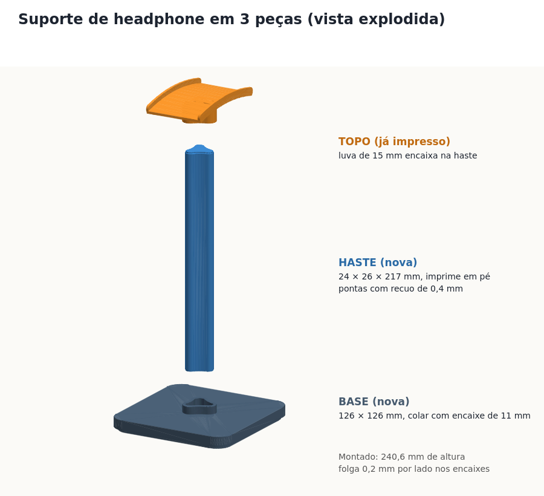

# Modelos 3D

| Pasta | O que é |
|---|---|
| `berco-teclado-casio-ct-s300/` | Berço colado com dupla face sob o Casio CT-S300 para encaixar no braço do suporte X. `berco_teclado.scad` é paramétrico. |
| `gancho-mochila-mesa/` | Gancho em "J" para mochila, parafusado na lateral da mesa. `gancho.py` gera o STL (`pip install manifold3d numpy`). |
| `suporte-headphone/` | Suporte de headphone baixado, dividido em 3 peças: `suporte_BASE.stl`, `suporte_HASTE.stl` e `suporte_TOPO.stl` (o modelo original fica em `_originais/`, fora do repo; `gerar_partes.py` refaz base e haste a partir dele). |

## Gancho de mochila

- Medidas: 51 × 100 × 30 mm, vão interno de 35 mm para a alça.
- Fixação: 2 parafusos de madeira 4 mm, cabeça chata (escareada), 25–30 mm de comprimento.
- Impressão: deitado de lado (perfil do "J" sobre a mesa, 30 mm de altura), sem suporte.
  Assim as camadas acompanham a curva e o gancho não racha sob o peso.
  PETG ou PLA, 4 paredes, 40% de preenchimento.

## Suporte de headphone (3 peças)

- Tudo em 97% da escala original (para encaixar no topo já impresso). Montado: 240,6 mm.
- Encaixes com 0,2 mm de folga por lado; o perfil triangular impede a haste de girar.
- **Base:** imprime deitada, sem suporte.
- **Haste:** imprime em pé (217 mm), sem suporte; use brim de 5–8 mm porque é alta e fina.
- **Topo:** luva para baixo, como já foi impresso.
